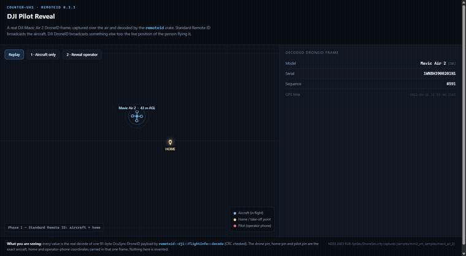

# remoteid

**A five dollar board can broadcast a drone that isn't there, and the
open-source Remote ID receivers people run believe it. remoteid is the one
that says SPOOFED.**



[**Live demo**](https://mattbusel.github.io/drone-demos/)

[](https://crates.io/crates/remoteid)
[](https://crates.io/crates/remoteid)
[](https://docs.rs/remoteid)
[](LICENSE)
[](https://github.com/Mattbusel/remoteid/actions/workflows/ci.yml)

Drone Remote ID (ASTM F3411-22a and ASD-STAN EN 4709-002, the FAA and EU
formats) in `no_std`, dependency-free, `#![forbid(unsafe_code)]` Rust: it
pulls the broadcast out of real Bluetooth and Wi-Fi frames, checks DRIP
(IETF RFC 9575, Ed25519) signatures when present, and hands back a verdict
on every transmitter instead of a map pin you are expected to trust. Every
decoded field is checked against the `opendroneid-core-c` reference library
on the public Open Drone ID sample captures, and CI rebuilds that library
and re-runs the comparison on every push. It builds for microcontrollers
(`thumbv7em-none-eabihf`) and the browser (`wasm32-unknown-unknown`).

**We threw 10 fake drones at the open-source Remote ID receivers people
actually run. Not one raised a flag.**

Your drone detector believes whatever the air tells it. Remote ID is a
broadcast, not a proof: any serial number, any position, any pilot
location, typed into a laptop script or a five dollar ESP8266. We built the
10 fakes from the public source of two spoofing tools and replayed them
through eight open-source receivers, 14 to 2,479 GitHub stars. If your
receiver can't say SPOOFED, it is a fake-drone amplifier: it takes an
attacker's broadcast and puts it on a security screen as a real aircraft.

| | Spoofed transmitters flagged | Shown to the user as real drones |
|---|---|---|
| Eight open-source receivers, combined | **0 of 10** | **62 of 80** receiver and transmitter pairs |
| The one receiver with a spoof check | 0 of 10 | 7 of 10 (it checks for an operator more than 15 km away; the spoofers put the operator next to the drone) |
| **remoteid** | **10 of 10** | **0** (real captures: 2 of 2 shown, none flagged) |

Every row, commit and file:line, with the command that reproduces it:
[docs/receivers.md](docs/receivers.md). Of the 18 pairs that did not
appear as drones, none were caught: they were never decoded. One ESP32
scanner reboots on the first Wi-Fi NAN frame it hears.

The hard part is not the format. The FAA rule makes drones broadcast who
they are and where the pilot stands, and nothing makes that broadcast
signed or checked. Authentication is an optional message, and the IETF says
it plainly: "even the most basic datum, the UAS ID itself, can be merely an
unsubstantiated claim" ([RFC 9153](https://www.rfc-editor.org/rfc/rfc9153)).
A receiver that only decodes is a parser with a map. It puts any serial
number anyone types into a five dollar board on a security dashboard, as a
real aircraft, with a real pilot location. If your product shows a drone
without saying whether to believe it, it is repeating the attacker.

remoteid takes the other side:

* **Every transmitter gets a verdict**: Authenticated, Plausible,
  Suspicious or Spoofed, with the reasons. No verdict is not an option.
* **DRIP signatures are checked** (IETF RFC 9575, Ed25519) when present,
  and Authenticated requires a receiver clock, so a replayed signature does
  not pass.
* **It still flags all 12 corpus spoofers with its spoofer fingerprints
  turned off**, so the result is not a rule written against two tools.
* **Your CI can fail on it.** `remoteid-replay` feeds the spoof corpus and
  real captures through any receiver that prints JSON and exits 1 when it
  accepts a spoofed transmitter:

```sh
cargo install remoteid --features cli
remoteid-replay run --receiver "python my_receiver.py --pcap {capture}"
```

```yaml
# GitHub Actions: the job fails when your receiver believes a spoofer
- uses: Mattbusel/remoteid@v0.3.2
  with:
    receiver: python my_receiver.py --pcap {capture}
```

Contract, options and the action: [docs/replay.md](docs/replay.md).

## Used by

* [dougborg/AirHound](https://github.com/dougborg/AirHound), an RF
  surveillance detection toolkit with ESP32 firmware, decodes Remote ID
  with remoteid (`default-features = false`).
* Listed as the Rust implementation in the
  [Open Drone ID reference C library](https://github.com/opendroneid/opendroneid-core-c#rust),
  whose decoder this crate is checked against field by field.

## What it is

Drone Remote ID for Rust. It decodes and encodes the broadcast messages of
**ASTM F3411-22a** and **ASD-STAN EN 4709-002** (the FAA and EU Remote ID
formats, implemented in C by [Open Drone ID](https://github.com/opendroneid)),
pulls them out of real radio frames, and judges whether to believe them
(`trust`: spoofed, suspicious, plausible or DRIP-authenticated, with the
reasons):

| Transport | Function |
|---|---|
| Bluetooth 4 legacy advertising | `ble::find_in_advertising_data`, `ble::parse_service_data` |
| Bluetooth 5 extended / long range | same functions; the payload is a message pack |
| Wi-Fi Beacon vendor element | `wifi::parse_frame`, `wifi::find_in_elements` |
| Wi-Fi NAN service discovery | `wifi::parse_frame`, `wifi::parse_nan_action` |
| Monitor mode captures | `wifi::strip_radiotap` (drops the FCS too) |
| pcap, pcapng and RIDF files | `capture::frames`, `capture::track` (std) |
| French beacon (pre-EU format) | `france::find_in_elements` |
| DJI DroneID, OcuSync (from an SDR demodulator) | `dji::FlightInfo::decode` |
| DJI DroneID, AntSDR TCP reports | `dji::antsdr::next_frame`, `dji::antsdr::Report` |
| DJI DroneID, Wi-Fi beacon element | `dji::find_in_elements` |

The core is pure Rust, no dependencies, `no_std`, no allocation outside the
optional `Tracker`, `#![forbid(unsafe_code)]`. It builds for
microcontrollers (`thumbv7em-none-eabihf`) and for the browser
(`wasm32-unknown-unknown`).

## Use

```toml
[dependencies]
remoteid = "0.3"
```

Bluetooth (for example service data from `btleplug` for UUID `0xFFFA`):

```rust
use remoteid::{ble, Frame, Message};

fn on_service_data(data: &[u8]) {
    let Ok(rid) = ble::parse_service_data(data) else { return };
    match rid.frame() {
        Ok(Frame::Message(Message::Location(loc))) if loc.is_plausible() => {
            println!("{:?} at {:?}, {:?} m", loc.status, loc.position(), loc.altitude_geo);
        }
        Ok(frame) => frame.for_each_message(|m| println!("{m:?}")),
        Err(e) => eprintln!("not decodable: {e}"),
    }
}
```

Wi-Fi monitor mode (radiotap frames from pcap, `libpcap`, or an ESP32):

```rust
use remoteid::{wifi, Tracker};

fn on_packet(tracker: &mut Tracker, radiotap_frame: &[u8], now_ms: u64) {
    let Ok(frame) = wifi::strip_radiotap(radiotap_frame) else { return };
    if let Ok(rid) = wifi::parse_frame(frame) {
        let uas = tracker.ingest_wifi(&rid, now_ms);
        println!("{:?}: {:?}", uas.data.primary_id(), uas.data.location.as_ref().and_then(|l| l.position()));
    }
}
```

Transmitting (for example from a Bluetooth 4 beacon):

```rust
use remoteid::{ble, BasicId, IdType, Message, UaType};

let id = BasicId::new(IdType::SerialNumber, UaType::HelicopterOrMultirotor, "1596F35074529ABCDEFG")?;
let mut adv = [0u8; 31];
let n = ble::write_advertising_data(0, &Message::BasicId(id).encode()?, &mut adv)?;
assert_eq!(n, 31);
# Ok::<(), remoteid::Error>(())
```

A complete program that reads a capture and prints every aircraft is in
[`examples/pcap_tracker.rs`](examples/pcap_tracker.rs):

```text
$ cargo run --example pcap_tracker -- tests/data/odid_wifi_bcn_sample.pcap
Wifi([132, 204, 168, 96, 67, 36])
  id:        Some("MFG1A0123456789")
  operator:  Some("GBR-OP-123ABCD")
  self id:   Some("Recreational")
  status:    Undeclared
  position:  Some((45.5470818, -122.9668346))
  alt geo:   Some(237.0) m, height Some(100.0) m
  speed:     Some(20.5) m/s, track Some(280.0) deg
  operator position: Some((45.5443876, -122.9726866))
  frames:    21 received, 2 est. missed, 0 duplicates, 0 undecodable
```

## What you get

* All six message types (Basic ID, Location, Auth, Self ID, System,
  Operator ID) and message packs, decode and encode. Unknown values
  ("no value" sentinels such as direction 361 or altitude -1000 m) decode to
  `None`; reserved enum codes are kept as `Other(u8)` so nothing is lost.
* `Location::check()` reports out of range values. The decoder accepts any
  bit pattern, as the C library does, so corrupted or spoofed frames still
  decode; call `check()` before you plot them.
* `BasicId::serial_number()` splits and validates ANSI/CTA-2063-A serial
  numbers (manufacturer code, length character, serial).
* `UasData` merges messages into one record per aircraft and joins
  multi-page authentication data (`auth_data`). With the `verify` feature,
  DRIP (RFC 9575) Ed25519 signatures are checked ([docs/drip.md](docs/drip.md));
  other schemes plug in through `auth::AuthScheme`.
* `trust` grades every transmitter `Authenticated`, `Plausible`,
  `Suspicious` or `Spoofed`, with the reasons ([docs/trust.md](docs/trust.md)).
* `Tracker` (with the default `std` feature) keys aircraft by radio address,
  counts duplicate and missed frames from the message counters, and expires
  aircraft that went quiet. It takes timestamps from the caller, so a
  replayed capture behaves the same as a live receiver.
* `serde` feature for `Serialize` / `Deserialize` on the decoded types.

## How it is tested

* **Against the reference C library.** Every distinct message in the three
  public Open Drone ID sample captures (82 messages, some of them corrupted
  in the air) was decoded by `opendroneid-core-c`; the test suite checks
  that this crate produces the same value for every field. Every one of the
  336 message packs is accepted or rejected exactly as the C library does.
  CI rebuilds the C library and regenerates these files on every push.
* **On real captures, end to end.** Wi-Fi Beacon, Wi-Fi NAN and Bluetooth 5
  long range captures go through `strip_radiotap` / `parse_frame` /
  `find_in_advertising_data` into the tracker. In the long range capture,
  the 28 frames the sniffer marked with a bad CRC are exactly the 28 frames
  the tracker reports as missed from counter gaps.
* **Round trips.** Values on the transmitted grid survive encode then
  decode exactly, and the Wi-Fi sample messages re-encode to the bytes that
  were on the air.
* **Random input.** 200,000 random and header-biased buffers through every
  parser, with no panic.

See [docs/testing.md](docs/testing.md) for how to regenerate the reference
data, [docs/format.md](docs/format.md) for the byte layouts, and
[docs/integration.md](docs/integration.md) for using it inside another
project (features, the API to depend on, MSRV, versioning).

## DJI DroneID

Many of the drones a detector sees are DJI, and DJI aircraft send their
own DroneID frames, on models sold before Remote ID and alongside it on
newer ones. A
detector that only reads ASTM Remote ID misses the pilot position DroneID
carries. The `dji` module decodes it:

* **OcuSync** (Mini 2, Mavic Air 2, Air 2S, Mavic 3 and most models since
  2019): give `FlightInfo::decode` the 91 bytes your SDR demodulator
  produced (for example the NDSS 2023 receiver from Ruhr University Bochum).
  The CRC is checked, so a demodulation error is an `Err`, not a drone in
  the wrong place.
* **AntSDR** DroneID firmware: `antsdr::next_frame` splits the TCP stream,
  `antsdr::Report` decodes each report.
* **Wi-Fi** DJI models: `dji::find_in_elements` reads the beacon vendor
  element (OUI `26:37:12`), flight telemetry and the user entered flight
  purpose.

```rust
use remoteid::dji::{self, FlightInfo, WifiDroneId};
use remoteid::{Tracker, Transmitter};

fn on_ocusync(tracker: &mut Tracker, payload: &[u8], now_ms: u64) {
    let Ok(f) = FlightInfo::decode(payload) else { return };
    println!(
        "{} {:?} at {:?}, pilot at {:?}",
        f.product_name().unwrap_or("DJI"),
        f.serial_str(),
        f.position(),
        f.pilot_position(),
    );
    // Same tracker, trust verdicts and aircraft.json as Remote ID aircraft.
    tracker.ingest_dji(Transmitter::Other(f.key()), &f, now_ms);
}

fn on_beacon(tagged_params: &[u8]) {
    if let Some(WifiDroneId::FlightInfo(f)) = dji::find_in_elements(tagged_params) {
        println!("{:?} home {:?}", f.serial_str(), f.home_position());
    }
}
```

What it gets right: coordinates are converted exactly (radians times 1e7;
the usual `/ 174533` shortcut is off by about 2 m), positions of 0, 0 are
`None` instead of a drone in the Gulf of Guinea, encrypted serials come back
as `None` instead of garbage text, and fields whose units nobody has
established publicly (altitude, height, velocities, state flags) are kept
raw instead of guessed. Tested against payloads demodulated from the NDSS
2023 sample captures: the CRC verdict matches the reference receiver on all
9 frames, and every field of the Mavic Air 2 frame is checked.

## Status

0.3: the message layer and transports are complete and checked against the
reference; trust verdicts and DRIP verification came in 0.2, the replay gate
and GitHub Action in 0.3, DJI DroneID decoding in 0.3.3. Not included yet: MAVLink `OPEN_DRONE_ID_*` conversion (the
MAVLink messages carry the same 25 byte payloads, so `Message::decode` works
on their data fields directly) and Network Remote ID (ASTM F3411 NetRID
JSON).

## License

MIT. The sample captures in `tests/data` come from
[opendroneid/wireshark-dissector](https://github.com/opendroneid/wireshark-dissector)
under the Apache License 2.0 (`tests/data/LICENSE-APACHE-opendroneid`); they
are not part of the published crate. The DJI DroneID test payloads in
`tests/data/dji_droneid_payloads.txt` were demodulated from the sample
captures of [RUB-SysSec/DroneSecurity](https://github.com/RUB-SysSec/DroneSecurity)
with its offline receiver; they are not part of the published crate either.
